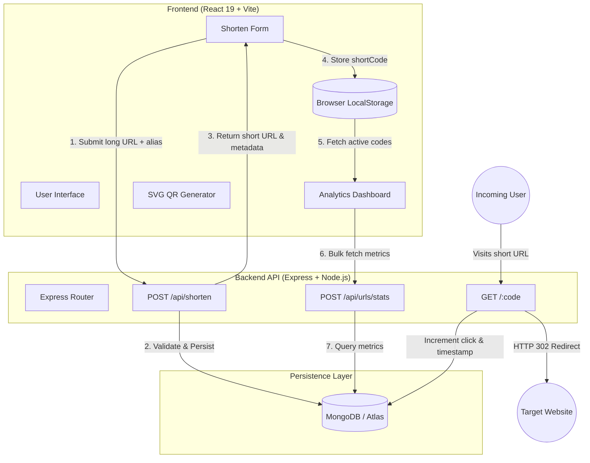

# LinkShort - Modern Full-Stack URL Shortener & Analytics

[](https://react.dev/)
[](https://vitejs.dev/)
[](https://nodejs.org/)
[](https://expressjs.com/)
[](https://www.mongodb.com/)
[](LICENSE)

A high-performance, full-stack URL shortening and link management platform engineered with the **MERN** stack (MongoDB, Express.js, React 19, Node.js) and Vite. Features instant HTTP 302 redirection, custom readable aliases, dynamic vector SVG QR code generation, real-time analytics aggregation, and a glassmorphic violet-themed dark UI.

---

## 📑 Table of Contents

- [Overview & Architecture](#-overview--architecture)
- [Key Features](#-key-features)
- [Tech Stack](#-tech-stack)
- [Project Directory Structure](#-project-directory-structure)
- [Getting Started](#-getting-started)
  - [Prerequisites](#prerequisites)
  - [Environment Configuration](#environment-configuration)
  - [Installation & Local Setup](#installation--local-setup)
- [API Reference](#-api-reference)
- [Technical Highlights & Engineering Decisions](#-technical-highlights--engineering-decisions)
- [Deployment Guide](#-deployment-guide)
- [License](#-license)

---

## 🏛️ Overview & Architecture

LinkShort provides high-speed URL redirection and tracking without requiring user registration. Links created by the user are stored locally in the browser's persistent storage, allowing users to track link performance privately.



---

## 🌟 Key Features

- **⚡ Fast Redirection**: Efficient $O(1)$ lookups via indexed MongoDB slugs delivering instant HTTP 302 redirections.
- **🏷️ Custom Slug Alias**: Allows customized aliases (`3-15` alphanumeric characters, hyphens, and underscores) alongside an automated 6-character random collision-resistant slug generator.
- **📊 Real-Time Analytics Dashboard**: Aggregates total shortened links, cumulative click counts, top-performing links, and individual link access timestamps.
- **🔒 Privacy-Focused Tracking (No-Auth Needed)**: Telemetry is scoped to the creator's browser session via `localStorage` sync with bulk database querying, removing the friction of login forms and tracking cookies.
- **📱 Dynamic Vector SVG QR Codes**: Built-in QR code generation with single-click SVG asset download for print and digital distribution.
- **🎨 Modern Dark UI / UX**: Violet-accented glassmorphism aesthetic with subtle animations, floating gradients, auto-prepending of `https://` schemas, clipboard copying, and global toast notifications.
- **🛡️ Custom 404 Fallback**: Dedicated branded error page when users visit invalid or expired short URLs.

---

## 🛠️ Tech Stack

### Frontend
- **Framework**: React 19 (via Vite)
- **Icons**: Lucide React
- **QR Code Rendering**: `qrcode.react` (SVG mode with Level H error correction)
- **Styling**: Vanilla CSS3 (Custom design tokens, glassmorphism, responsive CSS grid/flexbox)

### Backend
- **Runtime**: Node.js (ES Modules syntax)
- **Web Framework**: Express.js 4.x
- **Database ODM**: Mongoose 8.x
- **Validation**: `valid-url` & custom regex formatters
- **CORS & Config**: `cors`, `dotenv`

### Database
- **Engine**: MongoDB (Local or MongoDB Atlas)
- **Indexes**: Unique indexed `shortCode` for rapid redirection resolution

---

## 📂 Project Directory Structure

```text
Linkshortner/
├── backend/
│   ├── config/
│   │   └── db.js              # MongoDB Mongoose connection handler
│   ├── models/
│   │   └── Url.js             # Mongoose schema (originalUrl, shortCode, clicks, dates)
│   ├── routes/
│   │   ├── redirect.js        # Redirection endpoint (/:code) & 404 fallback page
│   │   └── url.js             # Shorten creation (/api/shorten) & bulk stats (/api/urls/stats)
│   ├── package.json           # Backend dependencies and run scripts
│   ├── server.js              # Express app bootstrap, middleware, and route mounting
│   └── .env                   # Backend environment variables (ignored by git)
│
├── frontend/
│   ├── public/                # Static public assets
│   ├── src/
│   │   ├── components/
│   │   │   ├── Dashboard.jsx      # Metrics overview (Total Links, Total Clicks, Top Link)
│   │   │   ├── LinkCard.jsx       # Individual link item, QR download, copy button
│   │   │   ├── Navbar.jsx         # Header brand bar
│   │   │   └── ShortenerForm.jsx  # Input form with validation & alias support
│   │   ├── App.jsx            # Core application state, localStorage sync, toast manager
│   │   ├── App.css            # Component-specific styles
│   │   ├── index.css          # Design system, glassmorphism tokens, and animations
│   │   └── main.jsx           # React DOM root entry
│   ├── index.html             # HTML entry template
│   ├── package.json           # Frontend dependencies and Vite build scripts
│   ├── vercel.json            # SPA rewrite routing rules for client-side deployments
│   └── vite.config.js         # Vite configuration & React plugin setup
│
└── README.md                  # Project documentation
```

---

## ⚙️ Getting Started

### Prerequisites
- **Node.js**: v18.0.0 or higher ([Download Node.js](https://nodejs.org/))
- **MongoDB**: Local MongoDB instance on port `27017` or a cloud [MongoDB Atlas](https://www.mongodb.com/atlas) cluster URI

---

### Environment Configuration

#### 1. Backend (`backend/.env`)
Create a `.env` file in the `backend/` directory:
```env
PORT=5000
MONGO_URI=mongodb://127.0.0.1:27017/linkshort
BASE_URL=http://localhost:5000
CLIENT_URL=http://localhost:5173
```
> *For cloud databases (e.g. Atlas), replace `MONGO_URI` with your connection string: `mongodb+srv://<user>:<password>@cluster.mongodb.net/linkshort?retryWrites=true&w=majority`.*

#### 2. Frontend (`frontend/.env`)
*(Optional for local development, defaults to `http://localhost:5000`)*
```env
VITE_API_BASE_URL=http://localhost:5000
```

---

### Installation & Local Setup

#### Step 1: Clone the repository
```bash
git clone https://github.com/vaibhavverma389/Linkshortner.git
cd Linkshortner
```

#### Step 2: Install and start Backend
```bash
cd backend
npm install
npm run dev
```
*The server will start at `http://localhost:5000`.*

#### Step 3: Install and start Frontend
Open a new terminal window:
```bash
cd frontend
npm install
npm run dev
```
*The Vite development server will start at `http://localhost:5173`.*

Open your browser and navigate to: **[http://localhost:5173](http://localhost:5173)**

---

## 📡 API Reference

### 1. Create Short URL
Shortens a target destination URL, with an optional custom slug.

- **Endpoint**: `POST /api/shorten`
- **Headers**: `Content-Type: application/json`
- **Request Body**:
  ```json
  {
    "originalUrl": "https://github.com/vaibhavverma389/Linkshortner",
    "customCode": "linkshort-repo" // Optional (3-15 alphanumeric, '-', '_')
  }
  ```
- **Responses**:
  - `201 Created`:
    ```json
    {
      "originalUrl": "https://github.com/vaibhavverma389/Linkshortner",
      "shortCode": "linkshort-repo",
      "shortUrl": "http://localhost:5000/linkshort-repo",
      "clicks": 0,
      "createdAt": "2026-10-25T16:30:00.000Z"
    }
    ```
  - `400 Bad Request`: Invalid URL format or alias already in use.
  - `500 Internal Server Error`: Server failure or code generation collision.

---

### 2. Bulk Sync Link Statistics
Fetches real-time click counts and timestamps for a given list of short codes.

- **Endpoint**: `POST /api/urls/stats`
- **Headers**: `Content-Type: application/json`
- **Request Body**:
  ```json
  {
    "codes": ["linkshort-repo", "aB81xY"]
  }
  ```
- **Responses**:
  - `200 OK`:
    ```json
    [
      {
        "originalUrl": "https://github.com/vaibhavverma389/Linkshortner",
        "shortCode": "linkshort-repo",
        "shortUrl": "http://localhost:5000/linkshort-repo",
        "clicks": 42,
        "createdAt": "2026-10-25T16:30:00.000Z",
        "lastAccessed": "2026-10-25T18:45:12.000Z"
      }
    ]
    ```

---

### 3. Redirection Endpoint
Redirects incoming traffic to the original destination URL.

- **Endpoint**: `GET /:code`
- **Behavior**:
  - Increments `clicks` by +1 and updates `lastAccessed`.
  - Returns `HTTP 302 Found` with `Location: <originalUrl>`.
  - If code does not exist, renders a styled `404 Not Found` HTML page.

---

### 4. Health Check
- **Endpoint**: `GET /health`
- **Response**: `200 OK`
  ```json
  {
    "status": "OK",
    "message": "API is running"
  }
  ```

---

## 💡 Technical Highlights & Engineering Decisions

1. **Collision-Resistant Slug Generation**: Uses a 62-character base charset ($[A-Z, a-z, 0-9]$) producing $62^6 \approx 56.8 \text{ billion}$ possible combinations with an automated 5-attempt retry loop to eliminate collisions.
2. **Indexed Database Lookups**: The `shortCode` field has a unique index in MongoDB, guaranteeing $O(1)$ lookup performance when processing redirects.
3. **Optimistic & Zero-Auth Client State**: By combining `localStorage` with a bulk query endpoint (`$in` operator query), the client avoids costly polling for individual items while respecting user privacy without cookies or auth tokens.
4. **Clean SVG Serializing**: Direct in-browser export of dynamic QR codes into downloadable vector `.svg` files using native `XMLSerializer` and object blobs—avoiding server-side image processing bottlenecks.
5. **SPA Direct Routing & Vercel Fallback**: Configured `vercel.json` rewrites and an in-app fallback redirect mechanism in React to resolve short links when routing through static CDN hosting.

---

## 🚀 Deployment Guide

### Backend (Render / Railway)
1. Push code to GitHub.
2. Create a new Web Service on [Render](https://render.com) or [Railway](https://railway.app).
3. Set the root directory to `backend`.
4. Build Command: `npm install` | Start Command: `npm start`.
5. Add environment variables (`PORT`, `MONGO_URI`, `BASE_URL`).

### Frontend (Vercel)
1. Import the repository into [Vercel](https://vercel.com).
2. Set Root Directory to `frontend`.
3. Framework Preset: `Vite`.
4. Set Environment Variable: `VITE_API_BASE_URL` pointing to your deployed backend URL.
5. Deploy.

---

## 📄 License

This project is licensed under the [MIT License](LICENSE).